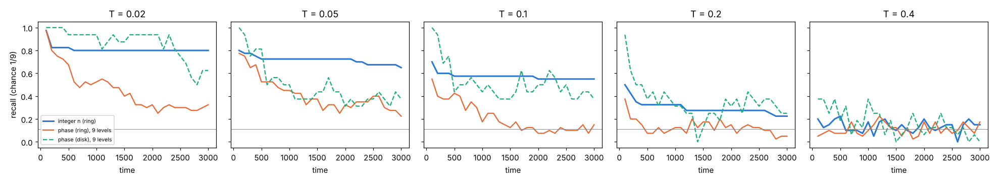
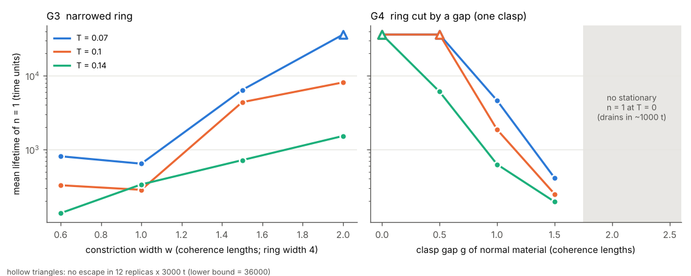

# AlexandersBrain

Can a loop in a medium hold memory by topology? This repo tests that in 2-D, with the
prediction written down before each gate was run ([PREDICTIONS.md](PREDICTIONS.md),
committed first).

It came out of the [BrainBoxClaude](https://github.com/anttiluode/BrainBoxClaude) and
[VMNClaude](https://github.com/anttiluode/VMNClaude) line. VMN found that **phase is memory,
but phase drifts, and reading phase writes it.** The idea tested here is that a
**winding number** fixes both: an integer that can only change when a vortex physically
crosses the material. Alexander's horned sphere enters as the clasp, a loop that almost
closes; G4 measures what such a loop can hold.

## The medium

An overdamped complex Ginzburg-Landau field ψ on a 64 × 64 grid (dx = 0.5), with Langevin
noise at temperature T and a material map μ(x):

    ∂ψ/∂t = ∇²ψ + (μ(x) − |ψ|²) ψ + ξ,     ⟨ξ ξ*⟩ = 2T δ(x−x′) δ(t−t′)

μ = +1 is ordered material (coherence length ξ = 1), μ = −1 is normal material. At T = 0 this is
a gradient flow of F = ∫ |∇ψ|² − μ|ψ|² + |ψ|⁴/2, and at T > 0 its stationary measure is e^{−F/T}.
A ring of radius 10 and width 4 is cut out of normal material. It holds two memories at once:

- **the integer n**: the winding ∮∇θ·dl = 2πn, gauge invariant;
- **the phase Θ**: ψ ≈ |ψ| e^{i(nφ + Θ)}, a continuous phase memory of the VMN kind.

Code: [`ab/tdgl.py`](ab/tdgl.py) (numba kernel, geometries, winding and phase estimators).

## Results

### G0: the medium is what it says ([g0_operator.py](gates/g0_operator.py))

- Laplacian correlation with the exact value 1.000; checkerboard gives −8, as it should.
  This is the sign bug Grok's PhiWorld code had.
- At T = 0 the free energy never increases (largest step +1.4 × 10⁻¹⁴).
- The ring holds n = 0..4 deterministically; n = 5 decays. So it can hold the 9 integers −4..4.
- |ψ|² in the bulk follows ψ₀² − k², with k = n/R, to within 5%.

### G1: noise ([g1_noise.py](gates/g1_noise.py), [g1b_diffusion.py](gates/g1b_diffusion.py))

Recall after 3000 time units, 8 rings per n (chance for the phase is 1/9):

| T | integer n = 0 / 1 / 2 / 3 / 4 | phase Θ, ring | phase, disk |
|---|---|---|---|
| 0.02 | 1.00 / 1.00 / 1.00 / 1.00 / 0.00 | 0.33 | 0.63 |
| 0.05 | 1.00 / 1.00 / 1.00 / 0.25 / 0.00 | 0.23 | 0.38 |
| 0.1 | 1.00 / 1.00 / 0.75 / 0.00 / 0.00 | 0.15 | 0.38 |
| 0.2 | 1.00 / 0.13 / 0.00 / 0.00 / 0.00 | 0.05 | 0.25 |
| 0.4 | ring melted, nothing holds | — | — |

- **The phase has no barrier at all.** It random-walks. The law
  d Var(Θ)/dt = T / ∫|ψ|² dA, with no free parameter, holds to within the statistical
  scatter: the measured/predicted ratio is 0.75–1.08 across 6 runs, each ±25%.
  So phase memory lasts for a time proportional to (area × amplitude²)/T, and nothing
  else helps it. The disk holds phase longer than the ring only because it has 2.5× the area.
- **The integer has a barrier, but only small |n| are safe.** A winding n means a
  current n/R flowing around the ring. Higher current brings the material closer to its
  critical current and lowers the barrier against a phase slip. Robust alphabet:
  |n| ≤ 3 at T = 0.02, |n| ≤ 2 at T = 0.05, |n| ≤ 1 at T = 0.1. One ring is a 3–7-level
  cell (1.6–2.8 bits), not a dense memory.

### G2: reading ([g2_read.py](gates/g2_read.py))

**Reading n, with no external reference.** Lower μ to μ_p on one patch of the ring for
30 t, then measure the phase drop across the patch between two points of the field itself.
The signal is linear in n: about 0.45 rad per unit at μ_p = 0.6, with a single-read sd of
about 0.2 at T = 0.05. 100 reads per ring:

| μ_p | rings whose n changed during 100 reads |
|---|---|
| 0.6 | none of n ∈ {−2..2}; all of \|n\| ≥ 3 (first change by read 1–8) |
| 0.3 down to −0.3 (full cut) | none of n ∈ {−1, 0, 1}; all of \|n\| ≥ 2 |

**Reading Θ needs a reference wave, and the reference rewrites it.** I injected a reference
ε e^{iφ_r} on a patch for 30 t, with T = 0 so any shift is read damage. One pair of reads
decodes Θ to 0.01–0.07 rad at ε = 0.01. After 100 reads, Θ has moved:

| ε | Θ moved after 100 reads | n changed |
|---|---|---|
| 0.01 | 0.01–0.29 rad | no (0/3) |
| 0.03 | 0.9–1.7 rad | no |
| 0.1 | 2.5–2.8 rad | no |
| 0.3 | 1.2–2.3 rad; all three rings end at the same value (decode error −0.07 for each) | no |

At ε = 0.3 the reads overwrote the memory with the reference's own value and then
agreed with it. That is VMN Gate 5 reproduced: the readout and the damage are the same
coupling. In the same rings, the winding n was never touched.

**Local holes.** I made a disk of radius r on the ring strongly normal for 20 t, then released it.
n = 1 survived every hole, **including r = 3, which cuts the whole width**. n = 3 was lost to
holes of r = 1, and n = 4 to r = 0.5. The cut heals because an open arc takes about 1000 t to
drain its current (measured below), and the hole closes long before that.

### G3 / G4: lifetimes, and the clasp ([g34_lifetime.py](gates/g34_lifetime.py), [g34_t0_long.py](gates/g34_t0_long.py))

**Which windings exist at all (T = 0, 4000 t of relaxation):**

| geometry | largest stationary n |
|---|---|
| narrowed ring, w = 0.6–1.5 | 1 |
| narrowed ring, w = 2.0–2.5 | 2 |
| narrowed ring, w = 3.0 | 3 |
| clasp gap g = 0 (closed) | ≥ 3 |
| gap g = 0.5 | 2 |
| gap g = 1.0–1.5 | 1 (a steady current crosses the gap; k = 0.088–0.095 constant from 1000 to 4000 t) |
| gap g ≥ 2.0 | **0**: any winding drains away within about 1000 t |

**Lifetime of n = 1 (12 replicas each, censored at 3000 t):**

| | T = 0.07 | T = 0.1 | T = 0.14 |
|---|---|---|---|
| w = 0.6 | 807 | 327 | 137 |
| w = 1.0 | 640 | 283 | 335 |
| w = 1.5 | 6388 | 4363 | 715 |
| w = 2.0 | > 36000 | 8090 | 1520 |
| g = 0 | > 36000 | > 36000 | > 36000 |
| g = 0.5 | > 36000 | > 36000 | 6056 |
| g = 1.0 | 4593 | 1856 | 627 |
| g = 1.5 | 410 | 248 | 195 |
| g ≥ 2.0 | 0 (no stationary state) | | |

- The clasp gives a **ladder of lifetimes** over about one coherence length of gap: more than
  36000 at g ≤ 0.5, about 4600 at g = 1, about 400 at g = 1.5, then a cliff to zero.
  The current tunnels across normal material (a Josephson weak link), and past about
  1.5–2 ξ there is too little coupling left to hold any current.
- Narrowing the ring does the same in the other direction: at T = 0.07, lifetime goes from
  640 at w = 1 to more than 36000 at w = 2, at least 56×.

## Prediction ledger

| # | Prediction | Result |
|---|---|---|
| G1.1 | phase diffusion = T/∫\|ψ\|², no free parameter | **pass** (G1b; ratios 0.75–1.08, within ±25% scatter). G1's centre-line estimator was too noisy to test it |
| G1.2 | n recall stays 1.00 wherever the ring is ordered | **fail**: only small \|n\| hold; the alphabet shrinks with T |
| G1.3 | disk holds phase no better than ring | **fail as stated**: the disk is better, by exactly its larger ∫\|ψ\|². The hole adds nothing to the phase; the area does |
| G1.4 | integer errors start at the highest \|n\| | **pass** |
| G2.1 | pinch signal separates all 9 n by > 3 sd | **fail**: linear in n but 2.2 sd per single read, and \|n\| ≥ 3 don't survive reading |
| G2.2 | non-destructive above a threshold, fragile for larger \|n\| | **pass** |
| G2.3 | reference read of Θ drifts it cumulatively; n intact | **pass**; at ε = 0.3 the memory is fully overwritten |
| G2.4 | n changes only when a hole cuts the full width | **fail**: n = 1 survives full cuts; n ≥ 3 dies to small holes. What matters is current versus the weakest point, plus cut duration versus drain time |
| G3.1 | lifetime rises with w, ≥ 2 decades over w = 1..3 | **partly**: rises from w = 1 on, at least 1.75 decades by w = 2 (censored); w = 0.6 ≈ 1.0 (both 1–2 grid cells wide) |
| G3.2 | ln τ linear in 1/T (Arrhenius) | **not supported**: 3 temperatures, curved for w ≥ 1. A barrier that itself shrinks with T (G12's noise-thins-the-order effect) would do this; untested |
| G4.1 | windings need g < g* ≈ 2–3 ξ; g* smaller for larger n | **partly**: g* is 1.5–2 for n = 1, 0.5–1 for n = 2, < 0.5 for n = 3 |
| G4.2 | lifetime falls faster than exponentially in g | **fail as measured**: about 10× per 0.5 ξ, not accelerating, then the existence cliff at g* |
| G4.3 | a clasp traps only within a few coherence lengths | **pass**: about 1.5 ξ here |

Corrections made along the way:
- The first G1 run hit the 1-hour job limit after two noise levels. Its log is kept in
  `results/g1_noise_run1_tmax6000_killed.log`; the rerun used tmax = 3000.
- The first T = 0 "which windings survive" check ran for 400 t. That is shorter than an
  open arc's own drain time, so it wrongly showed windings surviving at g ≥ 2.
  `g34_t0_long.py` (4000 t) replaces it; the 400 t calibration is kept but superseded.

## Auditing Gemini's horned-sphere brain

- *"Interior homeomorphic to an open 3-ball; π₁ of the exterior nontrivial."* Correct; that
  is Alexander (1924). The exterior's group is not even finitely generated.
- *"Signals trapped around the horns without touching the membrane."* True only in the
  infinite limit. Every finite stage is a tame sphere, and the complement of a tame sphere
  is simply connected, so nothing is trapped. A real medium only ever builds finite
  stages. G4 measures what a finite clasp does: it is a weak link with a gap, and it holds
  one quantum of current only if the gap is ≲ 1.5 coherence lengths.
- *"A_k ∝ (2r_k)^k = (2a)^k → ∞ for a < 1/2."* This contradicts itself: (2a)^k → 0 when a < 1/2.
  Counting properly, stage k has 2^k horns of area ∝ a^{2k}, so the added area goes as (2a²)^k
  and the total is finite. The horned sphere can be built with finite area and Hausdorff
  dimension 2. Its wildness is topological, not metric, so "D_f > 2 almost instantly"
  has no basis.
- *The growth PDE* ∂ρ/∂t = D∇²ρ + γ^k ρ(1 − ρ/ρ_max) evolves a scalar density. It carries no
  embedding, so it cannot produce or describe linking.
- *"Virtual junctions where signals jump topologically."* The physical version of this is the
  G4 weak link: coupling across a gap ∝ e^{−g/ξ}. It is local and exponentially weak, not
  an infinite-dimensional dense operator.

## Conclusions

1. **Topology fixes VMN's two costs, for small integers.** A phase memory has no barrier:
   its error grows like T·t/∫|ψ|², whatever you do, and it can only be read against a
   reference that pulls it (G1b, G2). A winding has a barrier, and it can be read
   relationally, field against itself, with zero damage below a threshold (G2: 100 reads,
   no change for |n| ≤ 2). That is a real, measured difference in kind.
2. **The price is a small alphabet.** Storing n means carrying a current. The barrier is set
   by the weakest cross-section and falls as the current rises, so only |n| ≤ 1–2 are safe at
   moderate noise. A ring is a bit or trit cell, not a dense store. Capacity comes from many
   rings, not from deep ones.
3. **Alexander's clasp, built in matter, is a Josephson weak link.** A loop that doesn't quite
   close holds n = 1 for gaps up to about 1.5 ξ, with lifetimes forming a ladder over one
   coherence length, and nothing beyond that. The wild sphere's infinitely fine clasps live
   below the coherence length, where the medium has no structure left to resolve them. So
   the buildable version of "Alexander's brain" is a network of rings with weak links. That
   is known engineering: superconducting flux logic (RSFQ, Likharev & Semenov 1991),
   persistent-current rings, atomtronic circuits. Nothing here is new physics; what this repo
   adds is the measured link back to VMN's read/drift problem and to the clasp question.
4. **Nothing here learns.** This is a memory cell. In BrainBoxClaude the learning lived in the
   slow material m, which wrote routes from forward × echo. The open step that would join
   them: let m write closed grooves, and see whether driven flow writes windings into those
   loops through phase slips at their weak links. That would be a medium that both learns
   routes and stores integers. It isn't built or tested.

## Reproduce

    pip install numpy scipy matplotlib numba
    python gates/g0_operator.py
    for T in 0.02 0.05 0.1 0.2 0.4; do python gates/g1_noise.py $T; done; python gates/g1_plot.py
    python gates/g1b_diffusion.py
    python gates/g2_read.py
    python gates/g34_t0_long.py
    for T in 0.07 0.1 0.14; do
      python gates/g34_lifetime.py constriction 1 $T 12 3000 0.6 1.0 1.5 2.0
      python gates/g34_lifetime.py gap 1 $T 12 3000 0.0 0.5 1.0 1.5
    done; python gates/g34_plot.py

Two CPU cores: about 4 hours in total. Noise streams are seeded per replica and per call.
